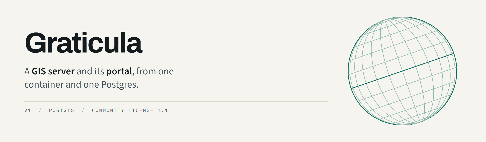

<picture>
  <source media="(prefers-color-scheme: dark)" srcset="docs/banner-dark.png">
  
</picture>

<p align="center"><a href="https://graticula.com"><b>graticula.com</b></a></p>

**A GIS server and its portal, in one process.** `Server` does what a GIS Server site
does — services at `/rest/services`, published out of PostGIS, opened by the clients you
already have. `Studio` does what the portal does for content and people — items, members,
roles, groups, sharing. `System`, where the server holds several organisations, is the system
administrator's: the organisations, the machine's status, log and settings
([ADR-221](docs/adr/ADR-221-the-system-administrator-has-a-surface-of-their-own.md)). ArcGIS Pro connects, browses,
adds the layer and edits it, and publishes and overwrites hosted feature layers with *Share As Web Layer*.

The three tiers are fused rather than federated
([ADR-019](docs/adr/ADR-019-portal-server-split.md)), so there is no site to create, no
data store tier to install and no portal to federate. Studio authors one thing: a **web map**
— layers, a basemap and a view, saved as an ArcGIS Web Map that Pro and the Maps SDK open
([ADR-079](docs/adr/ADR-079-a-web-map-is-a-saved-document.md)). No app builder, no dashboards,
no Living Atlas — the services are the product and the client is yours.

**[The overview page](https://erdinckyildiz.github.io/graticula/)** says the same thing
with room to breathe. A *graticule* is the net of meridians and parallels drawn on a map;
`Graticula` is the Medieval Latin word English borrowed it from.

> **v1, and every commit is a release.** Owner decision, 2026-09-10: the version moves to
> `1.0.0` and the patch advances on every commit, so `latest` is never behind the page you are
> reading. What that buys is the thing it was bought for — before it, `latest` was 247 commits
> and four schema migrations behind this README, and the publish endpoint documented below
> answered **404** to anybody who followed it.
>
> **It runs and it is tested; it has not yet been operated in production by anybody but its
> author.** That sentence outlived the version number it used to sit beside, and it is the
> half of it that was ever load-bearing.

---

## What runs

Five ArcGIS service types, plus the portal surface Pro, the Maps SDK and the API for Python connect through.

| | | |
|---|---|---|
| **Feature services** | complete | `query`, `applyEdits`, attachments, related records, `generateRenderer` — over a registered PostGIS table, a registered Oracle table ([ADR-205](docs/adr/ADR-205-a-registered-oracle-database-is-served-like-postgis.md): `SDO_GEOMETRY` with Z and M, no geodatabase, without versioning), a registered MySQL 8.0 or later table ([ADR-208](docs/adr/ADR-208-a-registered-mysql-database-is-served-like-postgis.md): spatial columns with an `SRID` and a spatial index, x and y only) or a hosted layer, and read-only over a GeoParquet file read in place, from a folder on the server or over `https://` and `s3://` ([ADR-066](docs/adr/ADR-066-geoparquet-layers-read-by-duckdb.md), [ADR-067](docs/adr/ADR-067-duckdb-sources-beyond-a-local-folder.md)). A query answers as JSON, GeoJSON or PBF, filters by time where a layer has a time field, and keeps Z and M where the data has them. On PostGIS, Oracle and MySQL layers it also takes a parsed `havingClause`, `queryTopFeatures`, `returnCentroid` and a statistic over an SQL expression ([ADR-197](docs/adr/ADR-197-the-arcgis-gap-review-s-second-half.md), [ADR-205](docs/adr/ADR-205-a-registered-oracle-database-is-served-like-postgis.md)); a hosted service's `updateDefinition` changes its capabilities, description, credits and page size |
| **Map services** | dynamic only | `export`, `identify`, `find`, `legend` and a sublayer `query`, drawn by time where a layer has one. A layer published without a style gets a generated appearance that reports itself as generated. An `f=json` export answers an output address that carries no token. **Not served:** a cached raster tile layer (`tile`, `singleFusedMapCache: false`) — a cached basemap is served as a vector tile service instead |
| **Vector tile services** | complete | Tiles from hosted data only ~~and from registered PostGIS tables ([ADR-095](docs/adr/ADR-095-registered-postgis-layers-serve-vector-tiles.md)), GeoParquet or DuckDB sources~~ (since 2026-10-20 a registered or file-based layer is drawn through its feature service, by owner decision: [ADR-206](docs/adr/ADR-206-vector-tiles-are-served-from-the-datastore-only.md)), a style document and a checked-in glyph set that labels in Latin, Greek, Cyrillic, Arabic, Hebrew, Armenian, Georgian and Thai, serves Devanagari, Bengali and Tamil that MapLibre draws unshaped, and leaves Chinese, Japanese and Korean to an image built with `GLYPHS_CJK=1` ([ADR-100](docs/adr/ADR-100-labels-in-more-scripts.md)). An edit made through this server empties the layer's tiles at once; **a registered table edited in another tool can be answered up to its cache lifetime late**, five minutes by default, ~~in its tiles~~ now in its query answers ([ADR-206](docs/adr/ADR-206-vector-tiles-are-served-from-the-datastore-only.md)). A service may carry several named styles, and a style may use sources on hosts an administrator allowed ([ADR-094](docs/adr/ADR-094-several-styles-and-allowed-origins.md)). **A sprite sheet is uploaded per service**, and a style's icons are checked against it ([ADR-092](docs/adr/ADR-092-sprites-are-uploaded-per-service.md)); **a layer's own picture markers are drawn on every face**, the tile style's from a sheet the server generates beside the uploaded one ([ADR-099](docs/adr/ADR-099-picture-markers-are-drawn-on-every-face.md)). There is no shared icon library. The cache can be seeded ahead of the first request as a resumable job ([ADR-093](docs/adr/ADR-093-seeding-the-tile-cache.md)), a service may have a cache quota, and an expired tile stands in while its source refuses. A service may be cut on a TUREF grid instead of Web Mercator ([ADR-096](docs/adr/ADR-096-a-vector-tile-service-may-be-tiled-in-another-reference.md)). The same tiles are served through OGC API Tiles, TileJSON and WMTS ([ADR-097](docs/adr/ADR-097-vector-tiles-through-ogc-api-tiles-tilejson-and-wmts.md)), and can be exported as a VTPK through ArcGIS's `exportTiles` or as a PMTiles archive, once the service's owner allows it ([ADR-098](docs/adr/ADR-098-vector-tiles-can-be-exported-as-a-package.md)); a PMTiles archive passes `pmtiles verify` and MapLibre draws it, and ArcGIS Pro opens and draws an exported VTPK on Web Mercator and on TUREF, and Esri's own export client (the Maps SDK Field Maps is built on) completes `exportTiles` against it; the Field Maps app itself has not been watched |
| **Image services** | complete | GeoTIFF, JPEG 2000, NetCDF, HDF, ERDAS Imagine and ASCII grids uploaded from Studio (the others converted to GeoTIFF; a NetCDF of variables over time and depth becomes a multidimensional service of slices, chosen by `multidimensionalDefinition`), or GeoTIFFs registered where they lie. A service is a mosaic dataset's catalog: `query`, `mosaicRule` with every mosaic method including seamlines ([ADR-161](docs/adr/ADR-161-a-seamline-is-the-halfway-line.md)) and every compositing operator (MT_MIN, MT_MAX, MT_MEAN, MT_BLEND, MT_SUM), `time`, and `add`, `update` and `delete`; Studio reorders its images. `exportImage` (PNG, JPEG, TIFF values, LERC), `identify`, `tile`, `getSamples`, `computeStatisticsHistograms`, `measure`, `computePixelLocation`, a raster attribute table, a Download capability and pyramids. Raster functions: Hillshade, Slope, Aspect, NDVI, BandArithmetic, ExtractBand, Clip, Remap, Mask, Statistics and Arithmetic, and the stretch, colormap and remap chains ArcGIS clients send. MrSID and ECW are refused by name: they are read only with their makers' SDKs, whose licences keep them out of this build |
| **Geometry service** | complete | All 22 operations, in the plane of the request's reference, and `lengths`, `areasAndLengths`, `distance`, `buffer` and `densify` on the ellipsoid as well when asked — `geodesic=true`, `calculationType=geodesic` or `preserveShape`, or metres in degrees ([ADR-198](docs/adr/ADR-198-the-geometry-service-measures-on-the-ellipsoid.md)); a geodesic buffer is PostGIS's, made in a projection it picks for each shape — including `buffer`, `intersect`, `union`, `difference`, `cut`, `project`, `autoComplete`, `reshape`, `trimExtend` and `findTransformations`, whose datum transformations come from a register generated from PROJ's and are applied by `project` as named ([ADR-160](docs/adr/ADR-160-datum-transformations-come-from-the-register.md)) |
| **ArcGIS Pro** | complete | Add a **portal** connection, sign in, browse My Content, add a layer, edit it. Measured against Pro over seven rounds, each read out of the request log ([ADR-040](docs/adr/ADR-040-the-portal-surface-is-how-arcgis-pro-connects.md)). Vector tile services draw in Pro 3.x, classified styles included. **Share As Web Layer with *Copy all data → Feature*** publishes a hosted feature layer into this server's datastore, with the layer's drawing, sharing level and groups, and **Overwrite Web Layer** replaces its data and keeps the item, its address and its sharing; a changed set of layers is refused ([ADR-191](docs/adr/ADR-191-arcgis-pro-publishes-hosted-feature-layers.md)). Add the portal as `https://<host>/studio` — Pro greys publishing for a portal at a root address. Map image, tile and vector tile layers, and *Reference registered data*, are not published from Pro |

| **ArcGIS API for Python** | partial | `GIS(url, username, password)` signs in through the portal's OAuth page as it does against Portal ([ADR-076](docs/adr/ADR-076-oauth-for-registered-apps.md)); content search, `FeatureLayer.append` to a hosted layer ([ADR-105](docs/adr/ADR-105-arcgis-clients-append-through-uploads.md)), and an item's `update`, `delete` and `unshare` for a service or a web map ([ADR-214](docs/adr/ADR-214-the-portals-item-writes-do-what-they-answer.md)). **Not served:** `content.add` of a file, and user and group administration (`portals/self/users`, `community/createGroup`) |
| **ArcGIS Maps SDK for JavaScript** | complete | An app whose portal is this server, on this origin or another ([ADR-072](docs/adr/ADR-072-cross-origin-reads-without-credentials.md) §5a), signs people in, opens saved web maps, and offers the basemap gallery and its default ([ADR-184](docs/adr/ADR-184-the-basemap-gallery-is-a-group.md)) |

Around them: members, roles with editable privileges, groups and item sharing, with every
mutation audited and the log queryable; import from GeoJSON, a zipped shapefile or a File
Geodatabase, or define an empty schema and fill it through `applyEdits`. **A basemap gallery** is a group whose
vector tile services and web maps every map offers as basemaps, one of them the default
([ADR-184](docs/adr/ADR-184-the-basemap-gallery-is-a-group.md)). **`graticula tools manifest`** writes a server's
data sources, services, groups, styles and sharing to one JSON file, by name and without credentials, and applies it
to another server ([ADR-183](docs/adr/ADR-183-the-catalogue-manifest.md), [docs/catalogue-manifest.md](docs/catalogue-manifest.md)).

OGC API Features (with Part 3's `filter` in Basic CQL2 text, [ADR-165](docs/adr/ADR-165-ogc-api-features-filters-in-basic-cql2.md)), WFS 2.0 and 1.1 ([ADR-168](docs/adr/ADR-168-wfs-1-1-0-is-spoken-too.md)), editable through WFS-T ([ADR-169](docs/adr/ADR-169-wfs-t-through-the-one-write-path.md)), and WMS 1.3.0 (taking an SLD with a request and answering GetStyles, [ADR-171](docs/adr/ADR-171-sld-at-the-wms-boundary.md)) are served as well — at `/wfs` and `/wms`, and at each service's own
address as ArcGIS gives it (`…/MapServer/WMSServer`, `…/ImageServer/WMSServer`, `…/FeatureServer/WFSServer`), with
image services as WMS layers ([ADR-162](docs/adr/ADR-162-ogc-at-a-service-s-own-address.md)), an image service's tiles
through WMTS at `…/ImageServer/WMTS` ([ADR-163](docs/adr/ADR-163-an-image-service-is-a-wmts.md)) and a map or image
service in Google Earth through `generateKml` ([ADR-164](docs/adr/ADR-164-generatekml-links-to-the-map.md)), an image
service's values as a WCS 2.0.1 coverage in GeoTIFF at `/wcs` and `…/ImageServer/WCSServer`
([ADR-170](docs/adr/ADR-170-image-services-are-wcs-coverages.md)), each of which its owner may turn off in Studio as ArcGIS Manager turns capabilities off ([ADR-166](docs/adr/ADR-166-ogc-faces-are-turned-off-one-by-one.md)) and whose documents carry the service's own description, keywords, fees and access constraints ([ADR-167](docs/adr/ADR-167-a-service-s-ogc-documents-describe-it.md)) and, for a European public body, its INSPIRE View and Download service settings ([ADR-172](docs/adr/ADR-172-inspire-view-and-download-services.md)) — and the vector tiles
through OGC API Tiles, TileJSON and WMTS 1.0.0 ([ADR-097](docs/adr/ADR-097-vector-tiles-through-ogc-api-tiles-tilejson-and-wmts.md));
[docs/](docs/) has the detail,
and [docs/reviews/](docs/reviews/) has the OGC CITE runs behind them.

## What is missing

On the front page on purpose. Each is a limit today, not a smaller version of something
that works.

- **PostGIS, Oracle, SQL Server, MySQL and MariaDB, for databases.** ~~No Oracle,~~ ~~No SQL Server,~~ ~~no MySQL,~~ No file geodatabase
  served in place. **Oracle since v1.0.441**
  ([ADR-205](docs/adr/ADR-205-a-registered-oracle-database-is-served-like-postgis.md)): a registered
  database's `SDO_GEOMETRY` tables are queried and edited in place, with Z and M, GlobalIDs, row versions and
  related records, and with attachments and a history where an administrator switches them on
  ([ADR-207](docs/adr/ADR-207-attachments-and-history-on-registered-layers.md), as for a registered PostGIS table) —
  no SDE, no versioning, a new row's key made by the database — and ~~an enterprise geodatabase on
  Oracle has to move first~~ an Esri enterprise geodatabase's own `ST_GEOMETRY` tables are not read. **MySQL
  8.0 or later since v1.0.446** ([ADR-208](docs/adr/ADR-208-a-registered-mysql-database-is-served-like-postgis.md)), to the same scope:
  query, edit, related records, attachments beside the table or in the datastore, and a history kept by triggers —
  x and y only, since MySQL stores no Z or M, and a row version computed from the row. A history needs the server to
  let the connected user create triggers (`log_bin_trust_function_creators` where a binary log is written), and a
  refusal says so. ArcGIS Pro has no MySQL database connection, so it reaches these layers through the FeatureServer.
  The console's *Add a source* dialog registers both, beside PostGIS ([D-310](docs/architecture-debt.md), repaired in
  v1.0.447). **MariaDB 10.6 or later since v1.0.447**, as a dialect of the same provider
  ([ADR-209](docs/adr/ADR-209-mariadb-is-a-dialect-of-the-mysql-provider.md)): registered as a MySQL source, told apart when connected,
  to MySQL's scope. MariaDB cannot say whether a shape is valid, and does not enforce a column's reference, so a publish
  says validity was not measured and counts any rows held in another reference. **SQL Server 2016 or later since
  v1.0.449** ([ADR-210](docs/adr/ADR-210-a-registered-sql-server-database-is-served-to-read.md)): `geometry` and
  `geography` tables queried and edited in place, x and y, a `geography` box drawn as the client drew it and a clockwise
  polygon turned the way SQL Server reads it — with attachments since v1.0.450, without a history or related records yet, registered through
  the admin API (`kind: "sqlserver"`). The host loads ICU for its driver and pins the invariant culture. SQL Server does
  not run on arm64, so the demo does not carry it. **On every registered database but DuckDB** an administrator
  switches on, from the console, attachments and the recording of who created and last edited each feature and when —
  the four columns added to the table in one step since v1.0.450 ([ADR-212](docs/adr/ADR-212-editor-tracking-on-a-registered-layer.md)). No
  registered source serves vector tiles ([ADR-206](docs/adr/ADR-206-vector-tiles-are-served-from-the-datastore-only.md)).
  The other engines are deferred, not cancelled — [v1-scope.md](docs/v1-scope.md) §3a. **GeoParquet files are the one
  thing served where they lie** — in a folder on the server, or over `https://` and `s3://` — and
  only for reading (a DuckDB database file or a MotherDuck database is **edited since v1.0.449**,
  [ADR-211](docs/adr/ADR-211-attached-duckdb-and-motherduck-tables-are-edited.md), where it can be opened for writing): no edits, no attachments, no related records, and a distance filter only
  in a projected reference — every other spatial relation is decided by the geometry engine the
  Geometry service runs ([ADR-066](docs/adr/ADR-066-geoparquet-layers-read-by-duckdb.md) §3a,
  [ADR-067](docs/adr/ADR-067-duckdb-sources-beyond-a-local-folder.md)). A remote file is read over
  the network on every query, at the bucket's latency. **A DuckDB database file and a MotherDuck
  database are served the same way**, their tables read-only; a file's geometry reference has to be
  declared, because DuckDB does not keep one in a database file.
- **Single sign-on is new, and not yet proven against a real provider.** OpenID Connect (Entra ID,
  Keycloak, Okta, Google), LDAP and Active Directory, and SAML 2.0 (AD FS, Entra ID) sign people in,
  and their groups there can decide their role and groups here
  ([ADR-088](docs/adr/ADR-088-sign-in-through-an-openid-connect-provider.md),
  [ADR-089](docs/adr/ADR-089-directories-and-group-mapping.md),
  [ADR-090](docs/adr/ADR-090-sign-in-through-a-saml-provider.md)). Each is tested against a
  provider the test suite runs, OpenID Connect and SAML against a real Keycloak too, and the directory
  against Samba's Active Directory domain controller — **not yet against a real Entra ID, AD FS or a
  Windows domain controller**. With Keycloak as the SAML provider, turn off
  its client's *Client signature required*: this server does not sign its requests.
  There is no SCIM: an account is made at its first sign-in or by hand, and a change of groups
  reaches this server at the person's next sign-in. Nested Active Directory groups are not
  followed, a SAML assertion must not be encrypted, and signing out ends this server's session only.
- **Several organisations in one deployment are new.** Each — a joint venture, say — has its own members,
  groups, content and administrator at its own host name, and PostgreSQL's row-level security keeps their rows apart;
  a group may admit another organisation's members, which is the only route between them, and one system
  administrator runs the machine above them all
  ([ADR-204](docs/adr/ADR-204-one-deployment-holds-several-organisations.md), [deployment §4](docs/deployment.md)).
  The server must connect as a role the security binds. Names are each organisation's own — services, folders,
  groups, data sources, usernames and the rest; only the managed datastore's is the server's — and so are custom
  roles; the built-in roles are shared, and fixed while there are several organisations. A member sees the groups
  of other organisations they are in on their own Groups page, and opens each at its organisation's host. Two
  organisations may partner, as in ArcGIS Online's partnered collaboration, and a group may admit only partners'
  members ([ADR-219](docs/adr/ADR-219-two-organisations-partner-before-their-groups-mix.md)); collaboration
  coordinators are not built. An item may also be shared with **all organizations on this server** — read by every
  organisation's signed-in members and by nobody anonymous — with its own privilege, held by administrators; ArcGIS
  clients see it as the organisation, and Studio's search finds it from another organisation
  ([ADR-220](docs/adr/ADR-220-an-item-may-be-shared-with-every-organisation.md)).
- **A second factor and API keys are new.** A member with a password here turns on
  a code from an authenticator app in the console or at `/rest/auth/second-factor`, and every sign-in page asks for
  it; a token request cannot carry one and says so ([ADR-201](docs/adr/ADR-201-a-member-may-have-a-second-factor.md)).
  Scripts sign in as a service account with an API key, sent as an ArcGIS token, which reaches the ArcGIS
  faces and never administers or owns anything
  ([ADR-200](docs/adr/ADR-200-service-accounts-sign-in-with-api-keys.md)); service accounts and their keys are
  made in Studio › Organization › Security, a key shown once. **A group may be public again**, found by
  anybody in the portal's group search ([ADR-199](docs/adr/ADR-199-a-group-may-be-public.md)).
- **Terms of use, content categories and favourites are new.** An item states its licence and sits in the
  organisation's categories, both in the portal's item document and `categorySchema`, and both are set on the item's
  page in Studio; the categories themselves are kept under Organization; a member keeps favourites, listed in
  Content ([ADR-202](docs/adr/ADR-202-an-item-has-terms-categories-and-favorites.md)). **A document — a PDF, Word or
  PowerPoint file, or a picture — is an item of its own**, uploaded from New item and downloaded, shared, replaced
  and deleted from its page ([ADR-188](docs/adr/ADR-188-a-document-is-an-item.md)).
  **A deleted service, image service, web map or document waits in the recycle bin for 14 days**, its hosted data with it, and
  comes back with its id ([ADR-203](docs/adr/ADR-203-a-deleted-item-waits-in-the-recycle-bin.md)); an image
  service waits with the image uploaded for it.
- **No offline editing.** No `createReplica` and no sync, so Field Maps offline areas and Pro's
  *Download Map* cannot take this server's features offline
  ([ADR-082](docs/adr/ADR-082-offline-sync-is-not-in-v1.md)). Vector tiles can be exported as a
  package for them ([ADR-098](docs/adr/ADR-098-vector-tiles-can-be-exported-as-a-package.md)), which
  has not yet been tried in either.
- **Analysis is built in; no geocoding.** The portal names a Spatial Analysis Service, as ArcGIS Enterprise's does, whose `AggregatePoints`, `JoinFeatures`, `SummarizeWithin`, `FindCentroids`, `CreateBuffers`, `DissolveBoundaries`, `MergeLayers` and `OverlayLayers` run as jobs, with the options ArcGIS documents for them — square and hexagon bins, a summary by a field's values, one- and many-to-one joins, one-sided and flat-ended buffers, snapping ([ADR-222](docs/adr/ADR-222-geoprocessing-is-built-in-analysis-tools.md)). They read this server's hosted layers or a feature collection sent with the request, and write a new hosted layer, overwrite one of yours, or return the result unsaved. Studio runs them from a hosted layer's page (*More › Analyze…*) and from the map's *Analysis* panel, which adds the result to the map; the ArcGIS API for Python runs them with its own functions. `ExtractData` is not built. **Python toolboxes** ([ADR-223](docs/adr/ADR-223-user-tools-run-sandboxed-on-grapy.md)): a member holding `content:publishTools` publishes a `.pyt` written against grapy (`import grapy as arcpy`, arcpy's documented names over GeoPackage, shapely and pyproj), and each of its tools is a GPServer task. A run is a process of its own that fences itself before the toolbox is imported — Landlock, seccomp, no network, limits on memory, CPU, files and time — reads hosted layers handed to it as files, and its feature class outputs are published as the caller's layers. On Linux only: elsewhere tools are refused unless an operator opts into an unsafe development setting. grapy builds the most-used part of arcpy so far; a name it lacks says so.
- **No *New ArcGIS Server* connection.** That handshake is SOAP; it is not built and not
  planned. A portal connection reaches the same content.
- **Backup is the server's own command, restore needs it stopped.** `graticula backup` and
  `graticula restore` take the database, the imagery and the certificate, and refuse a
  backup of another key or a newer schema; the secret key is never in a backup
  ([ADR-193](docs/adr/ADR-193-backup-and-restore-are-the-server-s-own-commands.md)). System › Backups takes,
  downloads and deletes one from the console, and keeps the newest few on a daily schedule; restoring is the
  command's alone.
- **Publishing from Pro is hosted feature layers only.** *Share As Web Layer* with *Copy all
  data → Feature* and *Overwrite Web Layer* work; map image, tile and vector tile layers and
  *Reference registered data* do not. Pop-ups set in Pro are not carried
  ([ADR-191](docs/adr/ADR-191-arcgis-pro-publishes-hosted-feature-layers.md)).
- **Migration reads ArcGIS Server only, and moves definitions, not data.**
  `graticula tools inventory` reports what would come across and what would not;
  `graticula tools migrate plan|apply` publishes the layers' definitions — their drawing and
  field aliases — over tables already registered here
  ([ADR-081](docs/adr/ADR-081-migration-publishes-definitions-over-registered-tables.md)).
  Sharing, editing settings, domains and subtypes are not carried, and GeoServer is not read.
- **Labels, script by script.** Latin, Greek, Cyrillic, Armenian, Georgian and Thai label on
  every face. **Arabic and Hebrew** label on every face, and MapLibre needs its RTL text plugin
  to draw them right to left and joined. **Devanagari, Bengali and Tamil** are drawn correctly
  on map images and **unshaped by MapLibre**, which does not form conjuncts. **Chinese, Japanese
  and Korean are not in the published image**: build it with `--build-arg GLYPHS_CJK=1`, which
  adds about 53 MB. Scripts outside these — Gurmukhi, Telugu, Sinhala, Ethiopic and others — are
  not carried ([ADR-100](docs/adr/ADR-100-labels-in-more-scripts.md)).
- **One machine.** No site, no clustering, no failover.

## Quickstart

Docker and Docker Compose. Nothing else — no .NET SDK, no PostgreSQL, no `openssl`.
These four commands are rehearsed on every push from an empty machine, so this section
is checked rather than remembered.

```bash
# Optional: pin a release rather than following `latest`. Both images are on GHCR and
# compose.yaml pulls them; with no network it builds from this repository instead.
export GIS_TAG=1.0.0

# 1. A key to seal registered data source credentials. There is no default, deliberately:
#    a published default key would make every credential in every deployment that forgot
#    to change it readable from a backup.
docker compose run --rm --no-deps server keygen
echo "GIS_SECRET_KEY=<the value it printed>" > .env

# 2. Create the schema. Explicit, never automatic — an old image started by accident must
#    not silently rewrite a newer schema.
docker compose run --rm server migrate --apply

# 3. Start.
docker compose up -d

# 4. The server has no administrator, so it refuses everything except setup and writes a
#    one-time token to its log.
docker compose logs server | grep -A2 "SETUP REQUIRED"

curl -k -X POST https://localhost:8443/rest/setup \
  -H "Content-Type: application/json" \
  -d '{"token":"<the token>","name":"root","password":"a properly long password"}'
```

`-k` because the server generates a self-signed certificate on first run and keeps it in a
volume. It survives a container replacement; install a real one when you have one.

`docker compose down` and `up` keeps the platform database, your registrations, accounts,
sessions and the serving certificate. Only `down -v` destroys it.

### Something to look at, with no database of your own

The four commands leave a server with nothing in it. If you have a PostGIS full of tables,
skip to the next section. If you are here to look at the thing, this is the shortest path from
*it started* to *a client can open it* — the compose file already registers its own datastore,
and an import puts a layer in it.

```bash
TOKEN=$(curl -sk -X POST https://localhost:8443/rest/auth/login \
  -H "Content-Type: application/json" \
  -d '{"name":"root","password":"a properly long password"}' | jq -r .token)

cat > places.geojson <<'EOF'
{"type":"FeatureCollection","features":[
 {"type":"Feature","properties":{"name":"Kadikoy"},
  "geometry":{"type":"Point","coordinates":[29.0257,40.9903]}},
 {"type":"Feature","properties":{"name":"Besiktas"},
  "geometry":{"type":"Point","coordinates":[29.0060,41.0430]}},
 {"type":"Feature","properties":{"name":"Uskudar"},
  "geometry":{"type":"Point","coordinates":[29.0150,41.0226]}}]}
EOF

curl -sk -X POST https://localhost:8443/admin/hosted/import \
  -H "Authorization: Bearer $TOKEN" \
  -F "name=places" -F "file=@places.geojson" -F "sharing=public"
```

It is a FeatureServer at
`https://localhost:8443/rest/services/hosted/places/FeatureServer/0` that any client can open
without signing in — `sharing=public` is what makes that true. An import is private to whoever
made it unless it says otherwise, so leave the line out for anything that is not a demonstration.
The console at
`https://localhost:8443/server/` will now show you a server with something in it. A zipped
shapefile or a File Geodatabase goes in through the same address.

### Publishing something

Sign in, test a database before registering it, register it, then publish a table.

```bash
TOKEN=$(curl -sk -X POST https://localhost:8443/rest/auth/login \
  -H "Content-Type: application/json" \
  -d '{"name":"root","password":"a properly long password"}' | jq -r .token)

# Creates nothing, and tells you which of the three failure classes you have: unreachable,
# connected but unprivileged, or connected but with nothing publishable.
curl -sk -X POST https://localhost:8443/admin/datasources/test \
  -H "Authorization: Bearer $TOKEN" -H "Content-Type: application/json" \
  -d '{"connectionString":"Host=your-db;Port=5432;Database=gis;Username=...;Password=..."}'

curl -sk -X POST https://localhost:8443/admin/datasources \
  -H "Authorization: Bearer $TOKEN" -H "Content-Type: application/json" \
  -d '{"name":"my-postgis","connectionString":"..."}'

# Layers are private to their owner until shared.
curl -sk -X POST https://localhost:8443/admin/layers \
  -H "Authorization: Bearer $TOKEN" -H "Content-Type: application/json" \
  -d '{"name":"places","dataSourceId":"<id>","schemaName":"public",
       "tableName":"places","geometryColumn":"geom","identityColumn":"objectid",
       "objectIdColumn":"objectid","srid":4326,"geometryType":"Point",
       "sharing":"public"}'
```

It is then a FeatureServer at
`https://localhost:8443/rest/services/places/FeatureServer/0`, discoverable from
`/rest/info` the way any ArcGIS client expects.

**A folder of GeoParquet files instead of a database.** Put the folder under `./geoparquet`
(compose mounts it read-only at `/data/geoparquet`, the only directory the server reads files
from — mount it writable if a DuckDB database file in it is to be edited, and know that while it is registered no
other program can open that file), register it by name, and publish a file the same way — its schema is `main` and its table
is the file name. The reference, the geometry column and the identity are read from the file, and
a publication that disagrees with them is refused.

```bash
curl -sk -X POST https://localhost:8443/admin/datasources \
  -H "Authorization: Bearer $TOKEN" -H "Content-Type: application/json" \
  -d '{"name":"reference","kind":"geoparquet","path":"istanbul"}'
```

**GeoParquet in S3 or on the web.** An `s3://bucket/prefix/` — every `.parquet` file directly under
it is a table — or one `https://…/name.parquet`. A public bucket needs only its region; a private
one takes an access key, and an S3-compatible store an `endpoint`. The secret is sealed and never
read back. A location that resolves to a private or loopback address is refused unless the
deployment sets `Graticula__RemoteDataAllowPrivate=true`. **The same check runs at every connection**,
redirects included: DuckDB reaches remote locations through a proxy inside the server that resolves
each destination and refuses a private one at the moment of connecting
([ADR-067](docs/adr/ADR-067-duckdb-sources-beyond-a-local-folder.md) condition 2). A deployment that
allows private addresses runs without it.

```bash
curl -sk -X POST https://localhost:8443/admin/datasources \
  -H "Authorization: Bearer $TOKEN" -H "Content-Type: application/json" \
  -d '{"name":"boundaries","kind":"geoparquet-remote",
       "url":"s3://overturemaps-us-west-2/release/2026-07-22.0/theme=divisions/type=division_area/",
       "region":"us-west-2"}'
```

**A DuckDB database, on this server or in MotherDuck.** Every table in the `main` schema with a
`GEOMETRY` column is a table to publish. A `.duckdb` file lives under `./geoparquet` like a folder does,
and is registered with the EPSG code its geometry is in: DuckDB 1.5.5 does not keep a reference in a
database file, so the registration says it, and a table whose coordinates cannot be in that reference
is refused when it is published. A MotherDuck database is registered by name with an access token from
MotherDuck's *Settings → Access Tokens*; its tables usually say their own reference. MotherDuck is off
unless the deployment sets `Graticula__MotherDuck=true` (`GIS_MOTHERDUCK=true` in `.env`), and the server
then downloads MotherDuck's extension from DuckDB's repository into its state volume the first time it is
used — the image does not carry it, because MotherDuck's terms do not say anybody else may redistribute it.

```bash
curl -sk -X POST https://localhost:8443/admin/datasources \
  -H "Authorization: Bearer $TOKEN" -H "Content-Type: application/json" \
  -d '{"name":"cadastre","kind":"duckdb","path":"istanbul/cadastre.duckdb","srid":4326}'

curl -sk -X POST https://localhost:8443/admin/datasources \
  -H "Authorization: Bearer $TOKEN" -H "Content-Type: application/json" \
  -d '{"name":"demo","kind":"motherduck","database":"graticula_demo","token":"'"$MOTHERDUCK_TOKEN"'"}'
```

### A service of several layers, in one act

One table is one layer. A service of several — with group layers, in a chosen order — is a
single request, written in one transaction or not at all. There is no empty container to make
first and fill afterwards: a service is not created without layers
([ADR-057](docs/adr/ADR-057-composing-and-publishing-a-service.md)).

```bash
curl -sk -X POST https://localhost:8443/admin/publish \
  -H "Authorization: Bearer $TOKEN" -H "Content-Type: application/json" \
  -d '{"name":"cadastre","folder":"hosted","sharing":"private",
       "srid":3857,
       "capabilities":["Query"],
       "nodes":[
         {"layer":{"name":"parcels","dataSourceId":"<id>","schemaName":"public",
                   "tableName":"parcels","geometryColumn":"geom","identityColumn":"objectid",
                   "objectIdColumn":"objectid","srid":4326,"geometryType":"Polygon"}},
         {"group":"Planning","layers":[
           {"name":"zoning","dataSourceId":"<id>","schemaName":"public",
            "tableName":"zoning","geometryColumn":"geom","identityColumn":"objectid",
            "objectIdColumn":"objectid","srid":4326,"geometryType":"Polygon"}]}]}'
```

`srid` is the reference the whole service answers in, whatever its tables are stored in —
reprojection happens on the way out. Where a grid has no EPSG code, send `sridWkt` with the
definition instead; the two are exclusive and the server refuses a reference it cannot project
to before it writes anything.

`capabilities` is a ceiling and never a grant: what a caller may do is that set intersected with
their privileges and with what the data supports. `servesFeatures` and `servesTiles` turn the
two faces on and off.

The same act has a screen — **Server › Publish** — which composes the tree by dragging tables
out of the registered databases, draws the result out of those databases *before* any of it is
published, and sends this request when you press Publish.

### If nobody can administer it any more

A store with accounts and no administrator cannot be recovered from the API, because every
route that would fix it needs the privilege that is missing. Setup does not re-arm itself:
a server that printed a fresh credential whenever the last administrator disappeared would
be printing one for whoever arranged that.

```bash
GRATICULA_ADMIN_PASSWORD='a properly long password' \
  docker compose run --rm -e GRATICULA_ADMIN_PASSWORD server \
  tools admincreator --name root
```

It refuses on a store that already has an administrator. `docker compose run --rm --no-deps
server --help` lists this and the other commands.

## Building

```bash
dotnet build
dotnet test --filter "Category!=Integration"
```

Integration tests need a PostgreSQL and are excluded by default. They **fail rather than
skip** when asked for without one — a test that goes green with its subject absent is worse
than no test, and this project has caught three instruments lying already.

```bash
export GRATICULA_TEST_PG="Host=localhost;Port=55432;Database=gis;Username=gis;Password=gis"
dotnet test --filter "Category=Integration"
```

One architecture test needs PROJ's own register rather than a database. `AxisOrder`'s table
is baked into the assembly ([ADR-060](docs/adr/ADR-060-the-axis-order-comes-from-the-register.md)),
and the whole cost of baking it is that it can fall behind EPSG — so the check regenerates
the file with `tools/axis-order.py` and compares bytes. PostGIS ships the register:

```bash
docker cp gis-experiment-postgis:/usr/share/proj/proj.db /tmp/proj.db
export GRATICULA_TEST_PROJ_DB=/tmp/proj.db
```

The conformance suite needs a **running server** and a fixture name for each shape it
checks. It also fails rather than skips, and each failure names the variable it wanted, so
a first run reads as a checklist. The fixtures cannot be discovered from the catalogue: a
published layer may legitimately have no tiles, and a server that had silently gone back to
one layer per service would pass every suite that looked for "a service".

```bash
export GRATICULA_TEST_URL="https://127.0.0.1:8443"
export GRATICULA_TEST_USER="root"
export GRATICULA_TEST_PASSWORD="…"
export GRATICULA_TEST_QUERYABLE="buildings"                     # a feature service
export GRATICULA_TEST_MULTILAYER="hosted/EarlyAlert_Reports_HD" # more than one layer
export GRATICULA_TEST_GROUPED="hosted/EarlyAlert"               # contains a group layer
export GRATICULA_TEST_TILE_SERVICE="hosted/parcels"             # has a VectorTileServer
export GRATICULA_TEST_EDITABLE="editable"                       # layer 0 accepts edits
export GRATICULA_TEST_LARGE="hosted/many"                       # enough features to queue
export GRATICULA_TEST_LOG="/var/log/graticula/server.log"       # the file the server writes
```

The last two are not fixtures in the same sense and are listed here because a first run
asks for them and this file did not. `GRATICULA_TEST_LARGE` needs a layer with enough
features that admission control has something to queue
([ADR-046](docs/adr/ADR-046-admission-control-bounds-the-queue-not-the-wait.md)).
`GRATICULA_TEST_LOG` is the path the server is writing to, because
[ADR-015](docs/adr/ADR-015-authentication.md) condition 2 requires redaction to be asserted
against real log output rather than against the call that produced it.

The console suite drives a real browser and finds one on the path by itself; set
`GRATICULA_TEST_CHROME` to a Chrome or Chromium executable when it cannot. It fails rather
than skips for the same reason as everything above: a console test that passes with no
browser has asserted that the console behaves.

## The record

Every decision here has an ADR with the alternatives it beat, every assumption has the
status of its evidence, and every temporary compromise has the condition that forces it to
be repaid. If you disagree with a choice, the argument it lost is written down.

```bash
python tools/status-page.py    # writes docs/status.html
```

Nothing on that page is typed by hand — the two versions that were went stale within a day,
and a status page that is wrong is most confidently wrong about whatever changed last.

- [docs/v1-scope.md](docs/v1-scope.md) — what is being built, and what was cut
- [docs/open-questions.md](docs/open-questions.md) — uncertainty is recorded, not hidden
- [docs/architecture-debt.md](docs/architecture-debt.md) — compromises, with repayment triggers
- [docs/reviews/](docs/reviews/) — three independent adversarial reviews and the OGC CITE runs
- [docs/build-vs-adopt-policy.md](docs/build-vs-adopt-policy.md) — what we write and what we
  adopt. No library type may appear in a core signature, and that is a build failure rather
  than a convention
- [benchmarks/mvt-generation/RESULTS.md](benchmarks/mvt-generation/RESULTS.md) — three
  measured rounds against 6.5 million OpenStreetMap polygons. Benchmark code is disposable
  and never promoted; the findings are what carried into the production types
- [CONTRIBUTING.md](CONTRIBUTING.md) · [SECURITY.md](SECURITY.md)

## Licence

**Graticula Community License 1.1** — source-available. Use it, run it commercially,
deploy it for clients, host it for third parties as a paid service, and pass on unmodified
copies. What needs the copyright holder's written permission is changing it: modifying it,
building on it, or distributing or running a modified version. Configuration through its
documented settings, environment variables and APIs is not a change
([ADR-180](docs/adr/ADR-180-the-outbound-licence-is-the-community-licence.md)).

Contributions are not accepted for now.

Releases up to and including v1.0.352 were published under the Elastic License 2.0
([ADR-047](docs/adr/ADR-047-the-outbound-licence-is-elastic-2.md)) and stay under it.

See [LICENSE](LICENSE), [NOTICE](NOTICE) and
[DEPENDENCY-LICENSES.md](DEPENDENCY-LICENSES.md).
